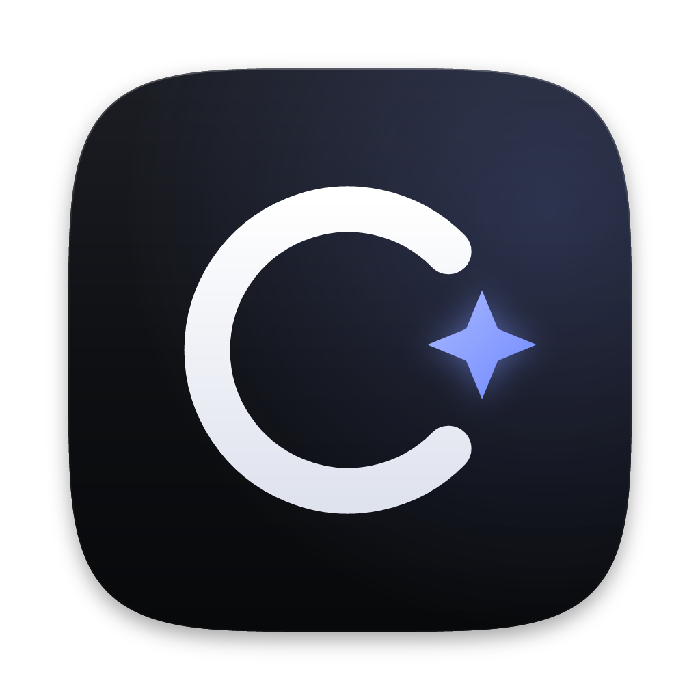

<p align="center">
  
</p>

<h1 align="center">Cleanly</h1>

<p align="center">
  Un nettoyeur de disque élégant et sûr pour Windows et macOS.<br>
  <a href="https://github.com/nicolasnt3-a11y/cleanly/releases/latest">Télécharger la dernière version</a>
</p>

<p align="center">
  <a href="https://github.com/nicolasnt3-a11y/cleanly/actions/workflows/ci.yml"></a>
  <a href="https://github.com/nicolasnt3-a11y/cleanly/releases/latest"></a>
  <a href="LICENSE"></a>
</p>

---

Cleanly libère de l'espace disque sans jamais mettre vos données en danger. L'application
explique ce qu'elle trouve, montre où passe la place et vous laisse décider : rien n'est supprimé
sans votre confirmation.

## Fonctionnalités

- **Analyse intelligente** : un seul bouton pour passer en revue le nettoyage, les applications,
  le démarrage et la protection.
- **Nettoyage** : fichiers temporaires, caches des navigateurs et des applications, rapports de
  plantage, résidus de Windows Update, caches de développement (npm, pip, Yarn, Xcode
  DerivedData…), journaux macOS, Corbeille, anciens téléchargements.
- **Explorateur d'espace** : carte interactive de ce qui occupe le disque, gros fichiers et
  doublons.
- **Applications** : liste des logiciels installés avec leur taille, désinstallation via le
  désinstalleur officiel.
- **Démarrage** : activation ou désactivation des programmes lancés à l'ouverture de session.
- **Protection** : état du pare-feu, de l'antivirus, du chiffrement du disque et des mises à jour.
- **Assistant IA (facultatif)** : avis sur les éléments à supprimer, via votre propre clé
  Anthropic ou OpenAI.
- Interface en français, thème clair/sombre, animations respectant « réduire les animations ».

## Garanties de sécurité

- **Suppression définitive uniquement pour ce qui se régénère** (caches, fichiers temporaires,
  journaux). Vos fichiers personnels (téléchargements, doublons, gros fichiers) partent
  **toujours dans la Corbeille** et restent récupérables.
- **Chemins recalculés dans le processus principal** : l'interface ne transmet que des
  identifiants ; les chemins réels sont redérivés côté système, jamais acceptés tels quels.
- **`realpath` + validation** de chaque chemin contre une liste de racines autorisées ; les
  dossiers système et sensibles sont refusés.
- **Aucun lien symbolique ni jonction n'est suivi.**
- **Les fichiers verrouillés ou en cours d'utilisation sont ignorés**, jamais forcés.
- **Règle des 24 h** : un fichier temporaire modifié il y a moins de 24 heures n'est pas touché.
- **Démarrage** : désactiver un programme écrit le même indicateur que le Gestionnaire des tâches
  de Windows (ou l'équivalent macOS) ; aucune entrée n'est jamais supprimée, tout est réversible.
- **IA** : seuls des noms, chemins et tailles sont envoyés, jamais le contenu des fichiers. Les clés
  API sont chiffrées avec `safeStorage` (DPAPI sous Windows, Trousseau sous macOS).
- **Protection** : ce module est en lecture seule et **ne remplace pas un antivirus**.
- Application durcie : `contextIsolation`, `sandbox`, CSP stricte, fusibles Electron
  (`runAsNode` désactivé, intégrité de l'archive ASAR vérifiée, `NODE_OPTIONS` et `--inspect`
  ignorés).

## Premier lancement

Les versions publiées ne sont pas encore signées par un certificat commercial : le système affiche
donc un avertissement la première fois.

### Windows

1. Téléchargez `Cleanly-Setup-<version>.exe` (installateur) ou `Cleanly-<version>-portable.exe`
   (version portable, sans installation).
2. Si SmartScreen affiche « Windows a protégé votre ordinateur », cliquez sur
   **« Informations complémentaires »**, puis sur **« Exécuter quand même »**.
3. L'installateur s'installe pour l'utilisateur courant (pas de droits administrateur requis) ;
   vous pouvez choisir le dossier d'installation.

### macOS

1. Téléchargez le `.dmg` correspondant à votre Mac : `mac-arm64` (Apple Silicon, M1 et suivants)
   ou `mac-x64` (Intel).
2. Glissez **Cleanly** dans le dossier **Applications**.
3. L'application est signée « ad hoc » mais pas notariée : avant la première ouverture, retirez
   l'attribut de quarantaine dans le Terminal :

   ```sh
   xattr -cr /Applications/Cleanly.app
   ```

   (Alternative : clic droit sur l'app → **Ouvrir**, puis confirmer, ou Réglages Système →
   Confidentialité et sécurité → **Ouvrir quand même**.)

## Développement

Prérequis : Node.js 22 ou plus récent, npm 11.

```sh
npm install          # npm 11 : approuver les scripts d'installation si demandé (npm approve-scripts)
npm run dev          # application Electron avec rechargement à chaud
npm run demo         # démo dans le navigateur avec des données fictives (sans Electron)
npm run typecheck    # vérification TypeScript (main + renderer)
npm run build        # compile dist/main, dist/preload et dist/renderer
npm run dist:win     # installateur NSIS + exécutable portable (release/)
npm run dist:mac     # .dmg + .zip arm64 et x64 (release/) — à lancer sur un Mac
npm run icons        # régénère build/icon.png, .ico et .icns depuis build/icon.svg
```

Structure :

| Dossier          | Contenu                                                              |
| ---------------- | -------------------------------------------------------------------- |
| `src/main`       | processus principal Electron (analyse, nettoyage, sécurité, IPC)      |
| `src/renderer`   | interface React                                                      |
| `shared`         | types partagés entre les deux processus                              |
| `build`          | icône source (`icon.svg`) et icônes générées                         |
| `scripts`        | scripts de build (esbuild, Electron, icônes)                         |

### Remarque NSIS (Windows)

Si `npm run dist:win` échoue avec une erreur NSIS du type **« could not open file »**, le chemin du
projet dépasse la limite de 260 caractères de Windows. Copiez ou clonez le projet dans un dossier
court (par exemple `C:\b\cleanly`) et relancez le build depuis là.

## Publier une version

1. Mettez à jour `version` dans `package.json` (par exemple `npm version 0.2.0 --no-git-tag-version`)
   et validez le changement.
2. Créez et poussez un tag `v*` :

   ```sh
   git tag v0.2.0
   git push origin v0.2.0
   ```

3. Le workflow [`release.yml`](.github/workflows/release.yml) compile Windows (NSIS + portable,
   x64) et macOS (`.dmg` + `.zip`, arm64 et x64), puis crée une **release GitHub publique** avec
   tous les fichiers. Un tag contenant un tiret (`v0.2.0-beta.1`) est publié comme pré-version.

Le workflow [`ci.yml`](.github/workflows/ci.yml) exécute `typecheck` et `build` à chaque push et
pull request.

## Licence

[MIT](LICENSE)
